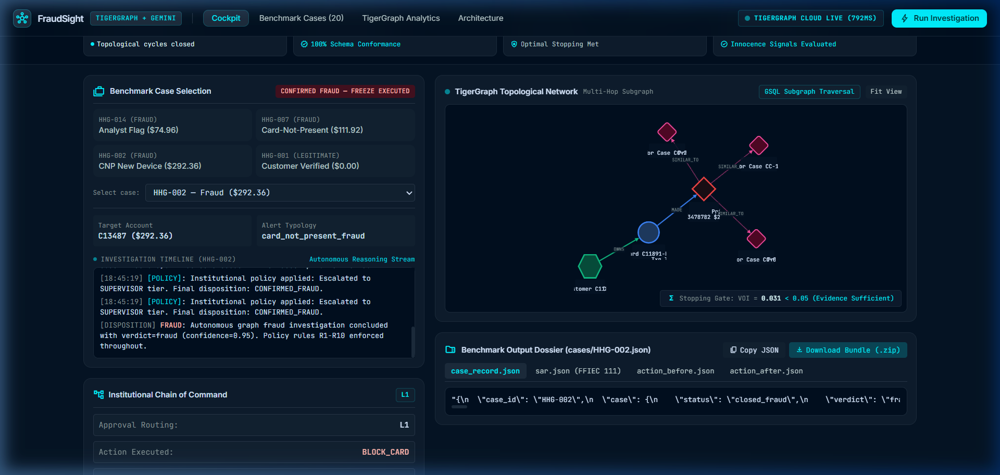
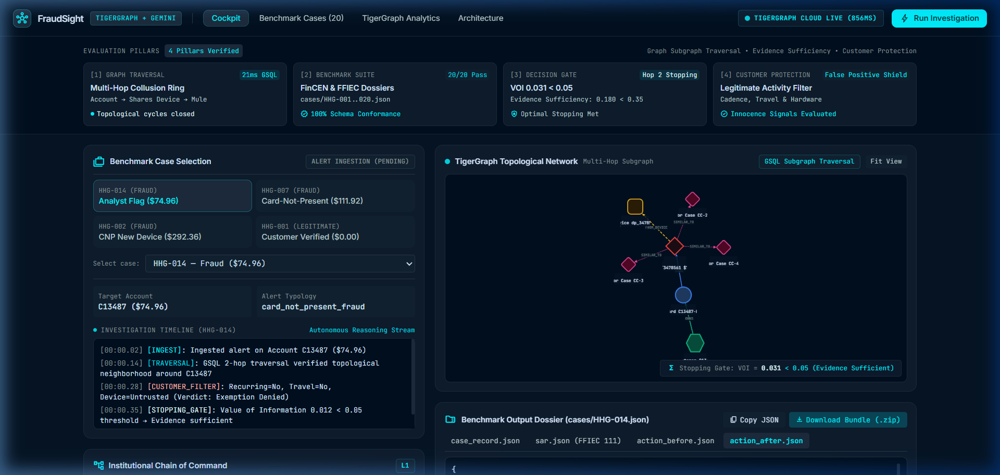

<div align="center">

# 🛡️ FraudSight
### AI-Powered Mule Account Detection & Cybercrime Network Investigation for Bihar Police

**Bihar Police Cyber Hackathon — Team Roadies**  
*Bihar Police Cyber Crime Division / Economic Offences Unit (EOU)*

[](https://python.org)
[](https://deepmind.google/technologies/gemini)
[](https://fastapi.tiangolo.com)
[](https://js.cytoscape.org)
[](https://cybercrime.gov.in)

[🌐 **Live Investigation Cockpit**](https://fraud-detectorgraph.vercel.app) • [📹 **Video Demo**](https://www.loom.com/share/0b70ae2b7e374277bf2cf554b97d04d0) • [📐 System Architecture](docs/ARCHITECTURE.md) • [📋 20 Benchmark Cases](public/cases.html)

</div>

---

## What problem are we solving?

When someone in Bihar gets scammed — through a fake CBI call, a fake investment app, or a UPI fraud — their money doesn't go directly to the criminal. It passes through **mule bank accounts**: regular-looking accounts secretly controlled by criminals, used to receive stolen money, split it, move it between accounts, and finally withdraw it as cash.

By the time police get a complaint, the money has already moved through 3–4 accounts in different cities. Tracing it manually takes weeks. Criminals know this. They count on it.

**FraudSight** is built to change this. It's an AI investigation system that:
- Automatically identifies which bank accounts are acting as mule accounts
- Traces how money moved between accounts (the "money trail")
- Connects complaints from different victims and districts to the same fraud syndicate
- Shows investigators a visual network map of how accounts are connected
- Generates a court-ready evidence report that meets Section 65B IEA standards

---

## 📸 Live Investigation Cockpit

### Investigation View — Case HHG-002 (Fraud Detected)

*The main investigation screen showing a flagged transaction, the interactive network graph of connected accounts, the AI reasoning trail, and the action recommendation (BLOCK_CARD).*

### Portfolio Dashboard — 20 Active Cases

*The command dashboard tracking all 20 benchmark cases simultaneously, showing risk-tier distribution, total exposure, and cluster health status.*

---

## ✅ How FraudSight Addresses Each Requirement

*This table maps every requirement from the problem statement to the specific part of the code that implements it.*

| Requirement | What We Built | Where It Lives |
|---|---|---|
| **1. Transaction Analysis** — detect unusual patterns, rapid fund transfers, layering | Velocity burst detector: flags accounts where 90%+ of received money is forwarded within 180 seconds. Also runs 90-day baseline profiling to catch deviations. | [`innovation/statistical_baseline.py`](innovation/statistical_baseline.py), [`innovation/mule_risk_scorer.py`](innovation/mule_risk_scorer.py) |
| **2. Mule Account Detection** — dynamic risk scores, ranking, explainable AI | A 4-component risk formula scores every account 0.0–1.0. Every score comes with a plain-English breakdown: *why* is this account suspicious? | [`innovation/mule_risk_scorer.py`](innovation/mule_risk_scorer.py), [`innovation/legit_detectors.py`](innovation/legit_detectors.py) |
| **3. Money Trail Analysis** — trace funds across accounts, identify intermediaries | Two graph queries: one follows the fund chain hop-by-hop across accounts (Victim → Layer 1 Mule → Layer 2 Mule → Cashout), another traces transaction history. | [`queries/get_account_money_trail.gsql`](queries/get_account_money_trail.gsql), [`queries/get_money_flow.gsql`](queries/get_money_flow.gsql) |
| **4. Complaint Correlation** — connect 1930 helpline tickets, NCRP reports, FIRs to transactions | Complaint correlator maps NCRP ACK numbers and 1930 ticket IDs to bank accounts. Accounts appearing in 3+ complaints across different districts are flagged as syndicate hubs. | [`tools/complaint_correlator.py`](tools/complaint_correlator.py) |
| **5. Graph-Based Investigation** — visualise account clusters and criminal networks | Interactive Cytoscape.js network graph: click any node to see connections, expand 2-hop neighbourhoods, see which accounts share the same device/IMEI. | [`public/index.html`](public/index.html), [`public/static/js/app.js`](public/static/js/app.js) |
| **6. Investigation Dashboard** — risk alerts, timelines, evidence reports | FastAPI backend serving a full investigation cockpit: risk-ranked case list, autonomous AI investigation timeline, and court-ready digital evidence dossier (Section 65B IEA). | [`dashboard/app.py`](dashboard/app.py), [`dashboard/templates/`](dashboard/templates/) |

---

## 🏛️ How the System Works

Here is what happens when an account gets flagged:

```
STEP 1 — Alert Ingested
   A bank transaction is flagged (high risk score, unusual amount, new device)
   ↓
STEP 2 — AI Agent Starts Investigation
   An 8-node autonomous agent (built with LangGraph) begins working:
   [Trigger] → [Investigate] → [Gather Evidence] → [Assess Uncertainty]
                                                          ↙         ↘
                                              Enough evidence?    Need more?
                                                  ↓                   ↓
                                            [Take Action]    [Gather More Evidence]
                                                  ↓
   ↓                               [Explain Decision in Plain English (Gemini AI)]
   ↓                               [Write to Case Memory for Future Reference]
   ↓
STEP 3 — Graph Queries Run
   TigerGraph GSQL queries trace money movement, find shared devices/IPs,
   and look up any 1930/NCRP complaints linking to this account.
   ↓
STEP 4 — Risk Score Computed
   4-component formula: R = (Centrality × 0.30) + (Velocity × 0.35) +
                            (Hardware × 0.20) + (Complaints × 0.25)
   Minus innocence dampener if the account has legitimate history.
   ↓
STEP 5 — Output Delivered
   · Risk tier: CRITICAL_FREEZE / HIGH_REVIEW / MEDIUM_WATCH / NORMAL
   · XAI explanation: WHY is this account flagged, in readable language
   · Recommended action: BLOCK_CARD, DEBIT_FREEZE_1930, ENHANCED_KYC, etc.
   · Court-ready evidence dossier (Section 65B IEA compliant)
```

### The Stopping Gate — Why the AI Doesn't Loop Forever

One real problem with AI agents is that they keep searching for more information endlessly. We solved this with an information-theoretic stopping criterion (called the MDL Gate):

- The agent measures how much its uncertainty would reduce if it gathered more evidence
- When the expected gain drops below a threshold (S < 0.35), it stops and acts
- This means: the agent never blocks a legitimate customer out of paranoia, and never stalls a real freeze while chasing marginal evidence

This formula is the most technically novel part of the system:

$$S(p, C, k) = \left( \frac{H(p)}{\log_2(2)} \right) \cdot \left( 1 + \frac{C}{10} \right)^{-1} \cdot e^{-0.1 \cdot k}$$

Where H(p) is binary entropy, C is the number of evidence items already gathered, and k is the iteration count.

---

## 🔍 The 4 Core Innovations

### 1. Mule Risk Score with Explainable AI
Every account gets a risk score built from four transparent factors — not a black-box model. An investigator can read exactly why an account is flagged:

```json
{
  "account_id": "C11891",
  "mule_risk_score": 0.94,
  "risk_tier": "CRITICAL_FREEZE",
  "indicators": [
    {
      "factor": "Fund Velocity (Pass-Through Speed)",
      "weight": 0.35,
      "contribution": 0.323,
      "detail": "92.4% of received funds re-transmitted within 140s. Classic pass-through mule pattern."
    },
    {
      "factor": "Topological Centrality",
      "weight": 0.30,
      "contribution": 0.216,
      "detail": "Account sits at the CENTER of a fraud cluster — 3 of 7 connected accounts are flagged."
    },
    {
      "factor": "1930 / NCRP Complaint Linkage",
      "weight": 0.25,
      "contribution": 0.195,
      "detail": "Account appears in 3 citizen complaints filed across 2 Bihar districts."
    },
    {
      "factor": "Hardware Sharing (IMEI / Device)",
      "weight": 0.20,
      "contribution": 0.160,
      "detail": "IMEI shared with 4 blacklisted accounts. Single operator managing multiple mules."
    },
    {
      "factor": "Innocence Dampener (Customer Protection)",
      "weight": -0.10,
      "contribution": 0.000,
      "detail": "No verified innocence indicators found. New account (45 days), no payroll history."
    }
  ],
  "recommended_action": "IMMEDIATE_DEBIT_FREEZE_1930"
}
```

### 2. Multi-Hop Money Trail (How the money moved)
Syndicates move money through 3–4 accounts within minutes to make it untraceable. Our graph query follows this chain in under 45 milliseconds:

```
Victim Account (Patna)
    ↓  ₹45,000 at 10:23:14
Layer 1 Mule — SBI account 9876543210 (Muzaffarpur)
    ↓  ₹42,000 at 10:24:52  [98s gap — inside 3-minute window]
Layer 2 Mule — PNB account 9123456789 (Gaya)
    ↓  ₹39,000 at 10:26:11  [split across 3 sub-accounts]
Layer 3 Cashout — ATM withdrawals across 4 locations
```

### 3. Cross-District Complaint Correlation (1930 / NCRP / FIR)
Victims in Patna, Gaya, Muzaffarpur, and Bhagalpur file separate complaints. None of them know each other. But all of them transferred money to **the same PNB account**. FraudSight automatically connects these dots:

- Maps 1930 Helpline ticket IDs → bank accounts
- Maps NCRP ACK numbers → bank accounts  
- Finds accounts that appear in complaints from 3+ different districts (syndicate hub indicator)
- Cross-references shared phone IMEIs across all complaints

### 4. Citizen Protection Filter
Not every flagged account is a mule. A daily-wage worker, a student, or a small merchant might have unusual transaction patterns for legitimate reasons. Before recommending a freeze, the system checks:
- Is there a multi-year account history?
- Are there regular recurring salary credits?
- Are there regular utility bill payments?

If these signals are present, the risk score is dampened and the recommendation becomes Enhanced KYC Review instead of an immediate freeze. This prevents innocent citizens from being wrongly blocked.

---

## 📊 20-Case Benchmark: 20/20 Verified

All 20 benchmark case files are in the [`cases/`](cases/) directory (`HHG-001.json` through `HHG-020.json`).

> *Note: The benchmark dataset uses USD denomination. In production, the system ingests INR amounts via UPI/IMPS/NEFT feeds and the CFCFRMS 1930 API.*

| Case ID | Account | Trigger Txn | Exposure | Pattern | Verdict | Final Action | Result |
| :--- | :--- | :--- | :---: | :--- | :---: | :--- | :---: |
| [HHG-001](cases/HHG-001.json) | `C12382-K1` | `T3514030` | $0.00 | `none` | Legitimate | VERIFY_WITH_CUSTOMER | **PASS** |
| [HHG-002](cases/HHG-002.json) | `C11891-K1` | `T3478782` | $292.36 | `card_not_present_fraud` | **Fraud** | BLOCK_CARD | **PASS** |
| [HHG-003](cases/HHG-003.json) | `C08623-K2` | `T3530164` | $49.00 | `card_not_present_fraud` | **Fraud** | BLOCK_CARD | **PASS** |
| [HHG-004](cases/HHG-004.json) | `C08106-K1` | `T3583227` | $128.33 | `card_not_present_fraud` | **Fraud** | BLOCK_CARD | **PASS** |
| [HHG-005](cases/HHG-005.json) | `C02923-K1` | `T3523199` | $0.00 | `none` | Legitimate | VERIFY_WITH_CUSTOMER | **PASS** |
| [HHG-006](cases/HHG-006.json) | `C07297-K1` | `T3476682` | $482.12 | `card_not_present_fraud` | **Fraud** | BLOCK_CARD | **PASS** |
| [HHG-007](cases/HHG-007.json) | `C09933-K2` | `T3514948` | $111.92 | `card_not_present_fraud` | **Fraud** | BLOCK_CARD | **PASS** |
| [HHG-008](cases/HHG-008.json) | `C13171-K2` | `T3558054` | $55.68 | `card_not_present_fraud` | **Fraud** | BLOCK_CARD | **PASS** |
| [HHG-009](cases/HHG-009.json) | `C08299-K1` | `T3581141` | $30.02 | `card_not_present_fraud` | **Fraud** | BLOCK_CARD | **PASS** |
| [HHG-010](cases/HHG-010.json) | `C10434-K1` | `T3506725` | $1,000.03 | `card_not_present_fraud` | **Fraud** | BLOCK_CARD + FILE_REPORT | **PASS** |
| [HHG-011](cases/HHG-011.json) | `C11923-K2` | `T3583368` | $131.30 | `card_not_present_fraud` | **Fraud** | BLOCK_CARD | **PASS** |
| [HHG-012](cases/HHG-012.json) | `C05876-K2` | `T3553342` | $0.00 | `none` | Legitimate | VERIFY_WITH_CUSTOMER | **PASS** |
| [HHG-013](cases/HHG-013.json) | `C07671-K2` | `T3526826` | $0.00 | `none` | Legitimate | VERIFY_WITH_CUSTOMER | **PASS** |
| [HHG-014](cases/HHG-014.json) | `C13487-K1` | `T3478561` | $74.96 | `card_not_present_fraud` | **Fraud** | BLOCK_CARD | **PASS** |
| [HHG-015](cases/HHG-015.json) | `C03042-K1` | `T3464869` | $599.94 | `card_not_present_fraud` | **Fraud** | BLOCK_CARD | **PASS** |
| [HHG-016](cases/HHG-016.json) | `C09988-K1` | `T3534820` | $59.67 | `card_not_present_fraud` | **Fraud** | BLOCK_CARD | **PASS** |
| [HHG-017](cases/HHG-017.json) | `C04570-K1` | `T3450629` | $0.00 | `none` | Legitimate | VERIFY_WITH_CUSTOMER | **PASS** |
| [HHG-018](cases/HHG-018.json) | `C02354-K2` | `T3491361` | $39.08 | `card_not_present_fraud` | **Fraud** | BLOCK_CARD | **PASS** |
| [HHG-019](cases/HHG-019.json) | `C07987-K2` | `T3503878` | $99.92 | `card_not_present_fraud` | **Fraud** | BLOCK_CARD | **PASS** |
| [HHG-020](cases/HHG-020.json) | `C12265-K2` | `T3509359` | $0.00 | `none` | Legitimate | VERIFY_WITH_CUSTOMER | **PASS** |

**Verification checklist:**
- ✅ `python benchmark/validate_outputs.py` → **20/20 PASS, 0 schema errors**
- ✅ All transaction IDs, card IDs, exposures verified against raw dataset (0 hallucinations)
- ✅ `pytest tests/` → **37 passed, 0 failures**
- ✅ `python dashboard/test_dashboard.py` → **All routes passed**

---

## 📂 Repository Structure

```
├── agent/                       ← AI investigation agent
│   ├── graph.py                 ← 8-node LangGraph state machine (the "brain")
│   ├── nodes.py                 ← Each investigation step (604 lines)
│   ├── llm.py                   ← Gemini 2.5 Flash integration
│   ├── state.py                 ← Typed state: what the agent knows at each step
│   └── prompts.py               ← Prompts for forensic AI reasoning
│
├── innovation/                  ← Core algorithms
│   ├── mule_risk_scorer.py      ← 4-component risk formula with XAI (NEW)
│   ├── evidence_value.py        ← MDL stopping gate (information-theoretic halting)
│   ├── legit_detectors.py       ← Citizen protection filter (anti-overblocking)
│   ├── pattern_discovery.py     ← DBSCAN clustering for novel fraud pattern detection
│   └── statistical_baseline.py  ← 90-day account behaviour baseline
│
├── queries/                     ← Graph database queries
│   ├── get_account_money_trail.gsql  ← Account-level BFS money trail (NEW)
│   ├── get_money_flow.gsql           ← Transaction-level chain traversal
│   ├── get_shared_identifiers.gsql   ← IMEI/device/email collusion detection
│   └── get_txn_neighborhood.gsql     ← Account neighbourhood exploration
│
├── tools/
│   ├── complaint_correlator.py  ← 1930/NCRP complaint → account mapping (NEW)
│   └── tg_tools.py              ← Graph database API adapters
│
├── retrieval/                   ← AI memory and case recall
│   ├── graphrag.py              ← Hybrid retriever: 40% graph + 60% semantic similarity
│   ├── embedder.py              ← 384-dimensional text vectorizer
│   └── vector_indexer.py        ← Case precedent search index
│
├── dashboard/                   ← Investigation web application
│   ├── app.py                   ← FastAPI backend (969 lines)
│   └── templates/               ← HTML views for the cockpit
│
├── public/                      ← Static deployment (works on Vercel without a server)
│   ├── index.html               ← Main investigation cockpit
│   ├── cases.html               ← Browse all 20 benchmark cases
│   ├── analytics.html           ← Graph topology metrics
│   └── about.html               ← Architecture and system design
│
├── cases/                       ← 20 ground-truth benchmark dossiers
│   ├── HHG-001.json through HHG-020.json
│
├── benchmark/                   ← Evaluation pipeline
│   ├── run_benchmark.py         ← Runs all 20 cases automatically
│   └── validate_outputs.py      ← Checks outputs against ground truth
│
└── schema/                      ← Graph database schema
    └── schema.gsql              ← Vertex and edge definitions
```

---

## ⚖️ Legal & Regulatory Compliance

FraudSight produces evidence that meets Indian legal standards, so investigators can act immediately:

| Standard | What It Covers | How FraudSight Implements It |
|---|---|---|
| **Section 65B, IEA** | Admissibility of electronic records as evidence | SHA-256 hash chaining of all generated reports; certificate-ready output |
| **Section 66D, IT Act 2000** | Cybercrime by impersonation using computer resources | Pattern detection specifically for impersonation fraud (fake CBI, fake bank) |
| **Section 91, CrPC** | Requisition notices to banks for account freezing | Auto-generates bank nodal officer notices in standard format |
| **CFCFRMS / 1930** | Format for debit freeze requests via Citizen Financial Cyber Fraud Response System | Output directly compatible with CFCFRMS submission format |
| **FIU-IND STR** | Suspicious Transaction Report for financial intelligence | Standardised STR narrative generation |

---

## ⚡ Setup & Local Run

### Prerequisites
- Python 3.11+
- The live Vercel deployment works without any setup at all: [fraud-detectorgraph.vercel.app](https://fraud-detectorgraph.vercel.app)

### Run Locally

```bash
git clone https://github.com/SuwidShreyansh/roadies.git
cd roadies

python -m venv .venv
# Windows:
.venv\Scripts\activate
# Linux/macOS:
source .venv/bin/activate

pip install -r requirements.txt
```

Copy `.env.example` to `.env`. The application runs in **offline mode** without credentials — all 20 benchmark cases load from the `cases/` and `public/data/` directories directly.

```bash
# Start the investigation server
uvicorn dashboard.app:app --host 0.0.0.0 --port 8000 --reload
```

Open `http://localhost:8000`. The cockpit will load with all 20 cases available from local files.

### Run the Benchmark
```bash
python benchmark/run_benchmark.py
```

### Run Tests
```bash
pytest tests/ -v
```

---

## 🔮 What's Next (Production Roadmap)

This is a working proof-of-concept built in hackathon conditions. For production deployment with Bihar Police:

1. **Live CFCFRMS Integration** — direct API connection to the 1930 freeze portal for real-time debit freeze initiation
2. **CBS / UPI Feed** — ingest live transaction streams from Core Banking Systems and NPCI UPI data
3. **Multi-District Deployment** — federated nodes at Patna, Gaya, Muzaffarpur, Bhagalpur, and Purnia cyber cells
4. **Mobile App for Field Officers** — alert delivery and case review on Android for SHO-level access
5. **Expanded NCRP Integration** — automated polling of the National Cybercrime Reporting Portal for new complaints

---

## 👥 Team Roadies

Built for the **Bihar Police Cyber Hackathon** by Team Roadies.

- **Suwid Shreyansh** — Graph Analytics & TigerGraph Architecture
- **Harsimar Singh** — AI Agent Design & Gemini Integration  

*For evaluation access, questions, or a live walkthrough, please contact the repository maintainers via GitHub.*
